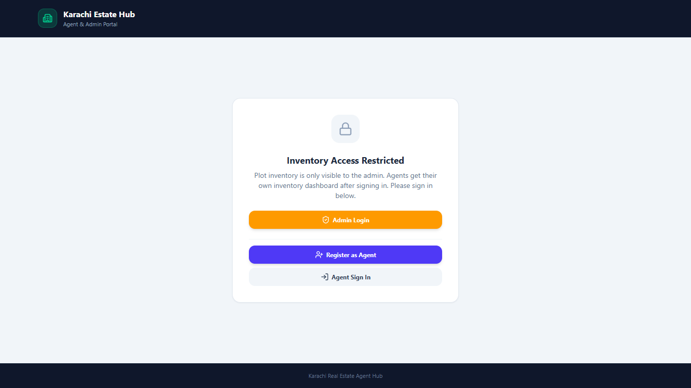
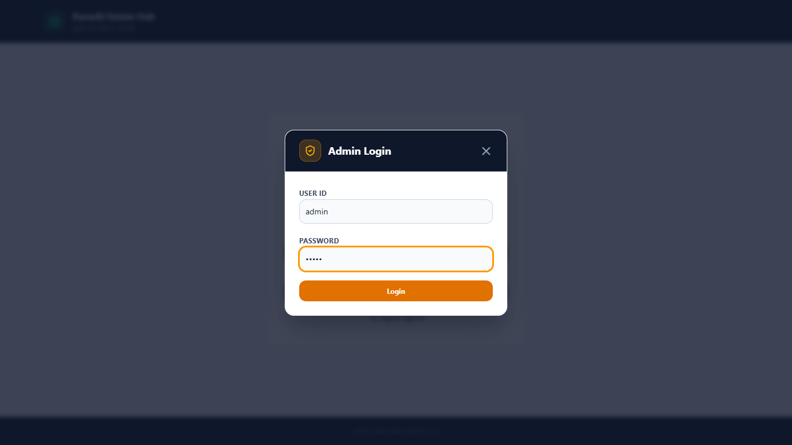
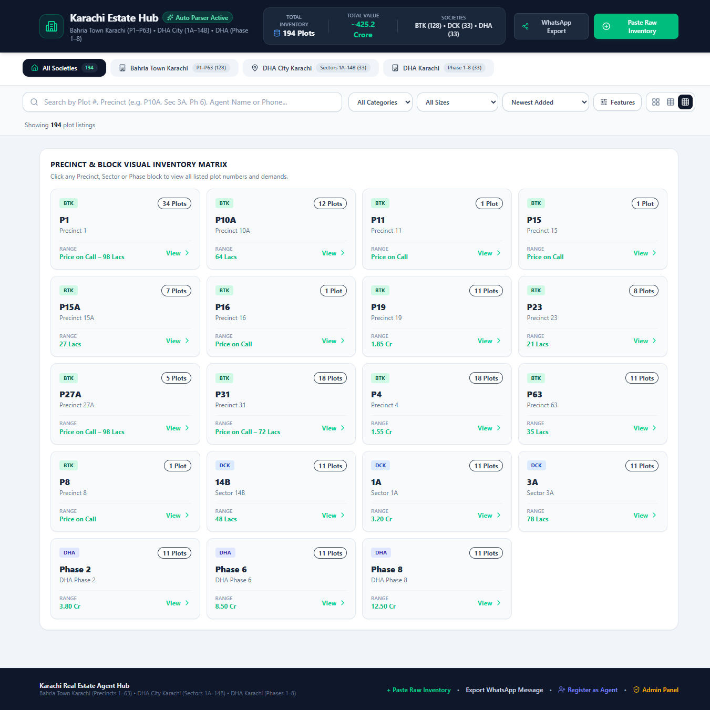
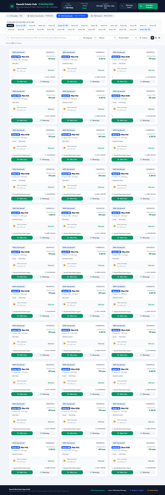
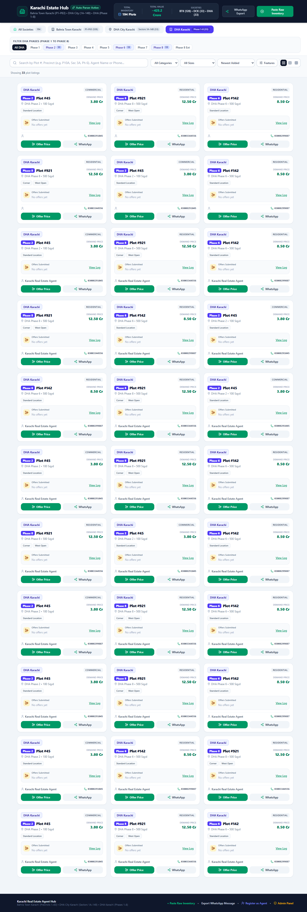

# Karachi Real Estate Plot Inventory & Bidding Platform (MERN)

A tool for Karachi real estate agents to manage plot inventory and offers
across Bahria Town Karachi, DHA City Karachi, and DHA Karachi. Built as a
MERN app (MongoDB, Express, React, Node) — plain JavaScript, no TypeScript.

```
RealEstate/
├── client/     React + Vite frontend
├── server/     Express + MongoDB backend
└── package.json  root scripts to run both
```

## Demo video

<!-- While editing this file on github.com, drag your demo MP4 onto this line. GitHub uploads it and inserts the link. -->

## Screenshots

**Home and admin login**

| Home (access restricted) | Admin login |
|---|---|
|  |  |

**Inventory views: grid, table and precinct matrix**




**Filter by society**

| Bahria Town Karachi | DHA City Karachi | DHA Karachi |
|---|---|---|
|  |  |  |

**Make an offer, and paste raw inventory for the auto parser**

| Offer form | Paste inventory parser |
|---|---|
|  |  |

## Features

- Inventory of plots across Bahria Town Karachi, DHA City Karachi, and DHA Karachi
- Grid, table, and precinct/sector matrix views, with filters for society, category, size, features, and price
- Paste raw listings (for example from WhatsApp) and turn them into structured plots with an AI parser (Gemini) or a built-in rule-based fallback
- Submit and track offers on each plot (Pending, Accepted, Rejected, Countered)
- WhatsApp-ready export of listings
- Agent registration with admin approval, then password sign-up and sign-in for approved agents
- Agents see only the listings they added; the admin sees the full inventory

## Prerequisites

- Node.js 18+
- A MongoDB instance — either running locally, or a free [MongoDB Atlas](https://www.mongodb.com/atlas) cluster
- (Optional) A [Gemini API key](https://ai.google.dev/) for AI-powered inventory parsing. Without one, the app automatically falls back to its built-in rule-based parser.

## Setup

1. **Install dependencies** (installs both `client` and `server`):
   ```bash
   npm run install:all
   ```

2. **Configure environment variables.** Copy the example env file and fill it in:
   ```bash
   cp server/.env.example server/.env
   ```
   Edit `server/.env`:
   ```
   MONGODB_URI="mongodb://localhost:27017/karachi_real_estate"
   GEMINI_API_KEY="your-gemini-api-key"   # optional
   PORT=5000
   ```

3. **Seed the database** (one-time, populates starting inventory):
   ```bash
   npm run seed
   ```

4. **Run the app** (starts both client and server together):
   ```bash
   npm run dev
   ```
   - Frontend: http://localhost:3000
   - Backend API: http://localhost:5000
   - The Vite dev server proxies `/api/*` requests to the Express server, so the frontend just calls relative paths like `/api/plots`.

## Running client/server separately

```bash
npm run dev:server   # Express API on :5000
npm run dev:client   # Vite dev server on :3000
```

## API endpoints

| Method | Path | Purpose |
|---|---|---|
| `GET` | `/api/plots` | Get all plots (or one agent's with `?ownerAgentId=`) |
| `POST` | `/api/plots/import` | Insert newly parsed plots |
| `POST` | `/api/plots/:plotId/offers` | Add an offer to a plot |
| `PATCH` | `/api/plots/:plotId/offers/:offerId` | Update an offer's status |
| `POST` | `/api/parse-inventory` | Parse raw pasted text into structured plots (Gemini, with rule-based fallback) |
| `POST` | `/api/agents/register` | Register an agent (starts as Pending) |
| `GET` | `/api/agents` | List agents (admin panel) |
| `PATCH` | `/api/agents/:agentId/status` | Approve or reject an agent |
| `POST` | `/api/agents/signup` | Set a password for an approved agent |
| `POST` | `/api/agents/login` | Agent sign-in |

## Notes

- All data is stored in MongoDB — no more browser `localStorage`.
- **Demo-level security:** the admin login is a hard-coded demo credential in the frontend, and sign-in state is kept in the browser only (no tokens or server-side sessions yet). Do not use this as-is in production. Adding JWT auth and protecting the API routes is the planned next step, along with real-time sync across open clients.
